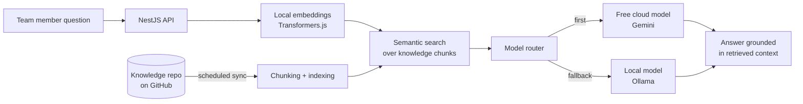

# Private AI Assistant with RAG — Case Study

> Internal AI assistant I built for **Vale Verde Festas**: runs on the company's own server, answers the whole team through the browser, and grounds every answer in the company's knowledge base.
> **Source code is private.** This repository documents the project; a live walkthrough is available on request.

## Goals

1. **Zero AI API cost** — local open-source models plus free-tier cloud models.
2. **Every answer follows the company's official knowledge base**, whichever model produced it.
3. **Knowledge stays up to date automatically** — the server syncs the knowledge repository from GitHub on a schedule.
4. **Secure access** — login for the team, no server exposed to the internet (Cloudflare Tunnel only).

## How it works

- **RAG pipeline**: the knowledge base is split into chunks, embedded **locally** (`@huggingface/transformers`, no API cost) and searched semantically for each question.
- **Model router**: free cloud models answer first, the on-premise model is the fallback; the order is configurable from the UI.
- **Runs as a Windows service** on the company server (Xeon, 32 GB RAM, no GPU) — model choice was sized to that hardware.
- **Auth** with Argon2-hashed passwords and session cookies; Zod validation throughout.
- Roadmap: file features (review documents, generate documents and spreadsheets).

## Engineering

- Monorepo (`apps/api`, `apps/web`, `apps/worker`), Prisma + PostgreSQL, typed API client generated from the contract (Orval).
- Quality gates: Vitest, dependency-cruiser, Knip (dead code), OSV-Scanner (vulnerable dependencies).
- ~37k lines of TypeScript, 120+ test files.

## My role

Design and implementation end to end: hardware sizing, RAG pipeline, model routing, API, UI, security and deployment plan.

---
Built by **Victor Sestrem** · [LinkedIn](https://www.linkedin.com/in/victor-sestrem/) · victor-sestrem@hotmail.com
